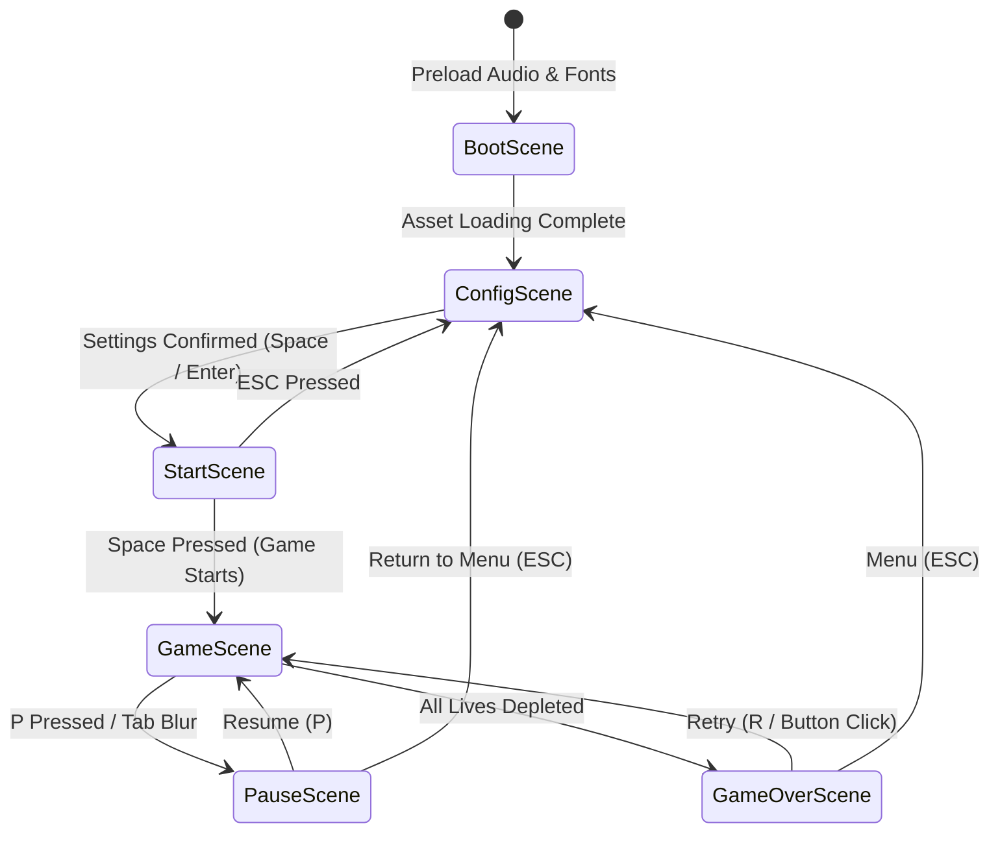

# Technical Reconnaissance and Phaser 3 Porting Plan: Asteroids (Boot.dev Extended)

> **Document Type:** Technical Reconnaissance & Browser Porting Specification  
> **Source Repository:** `asteroids-bootdev` (Python 3.13 / Pygame 2.6.1 / Pygbag)  
> **Target Platform:** Browser-native (Phaser 3 + TypeScript + Vite)  
> **Target Canvas:** 1280 × 720 (16:9), 60 FPS  
> **Status:** Final Architectural Reconnaissance & Parity Blueprint  

---

## 1. Executive Summary

### 1.1 Project Identity & Genre Discovery
The repository contains an extended **Asteroids arcade clone** originating from the [Boot.dev](https://boot.dev) Python guided curriculum, subsequently expanded into a feature-rich, local multiplayer arcade game.

It is **not** Space Invaders. There are no descending enemy rows, shields/bunkers, or rhythmic step-marching. The gameplay revolves around a triangular spacecraft flying in 2D space, destroying circular asteroids that split upon destruction, evading enemy flying saucers (UFOs), and harvesting power-ups.

However, the game makes several critical mechanical departures from the classic 1979 Atari *Asteroids*:
1. **Direct Translation vs. Inertial Drift:** In classic *Asteroids*, thrust applies linear acceleration and the ship drifts through frictionless space. In this codebase ([player.py](file:///c:/Users/davej/dev/asteroids-bootdev/player.py#L309-L316)), movement is direct displacement (`position += forward * PLAYER_SPEED * dt`). Releasing the thrust key halts the ship instantly; pressing reverse moves backwards immediately.
2. **Screen Boundary Bouncing vs. Toroidal Wrapping:** The player does **not** wrap around screen edges. Reaching any screen border clamps position and imparts an elastic bounce velocity (`BOUNDARY_BOUNCE_FORCE = 150 px/s`) with spark particles and screen shake ([player.py](file:///c:/Users/davej/dev/asteroids-bootdev/player.py#L320-L362)).
3. **Asteroid Boundary Despawning:** Asteroids spawn at outer screen edges, traverse the playfield, and are destroyed (`self.kill()`) when they cross the opposite boundary ([asteroid.py](file:///c:/Users/davej/dev/asteroids-bootdev/asteroid.py#L140-L145)). Only UFOs and PowerUps wrap around screen boundaries ([ufo.py](file:///c:/Users/davej/dev/asteroids-bootdev/ufo.py#L160-L168), [powerup.py](file:///c:/Users/davej/dev/asteroids-bootdev/powerup.py#L196-L205)).
4. **Entirely Procedural Vector Rendering:** The game uses zero raster sprite assets for gameplay entities. Ships, asteroids, lasers, UFOs, particles, and power-up icons are 100% drawn at runtime using Pygame vector drawing primitives (`pygame.draw.polygon`, `circle`, `line`, `rect`, `arc`).

### 1.2 State of Completion
The project is a **substantially complete and polished playable arcade game** with an automated test suite containing 68 passing unit tests across 15 test files.

| Feature Area | Implementation Status | Functional State |
| :--- | :--- | :--- |
| **Core Gameplay** | Complete | Player movement, shooting, asteroid splitting, life counter, game over flow. |
| **Multiplayer Co-op** | Complete | 1P and 2P local modes, individual or shared life pools, friendly fire toggle, speed handicaps ([controlconfig.py](file:///c:/Users/davej/dev/asteroids-bootdev/controlconfig.py)). |
| **Combat Mechanics** | Complete | Standard shots, 3-way multi-shot, rapid fire, penetrating raycast laser beam ([laserbeam.py](file:///c:/Users/davej/dev/asteroids-bootdev/laserbeam.py)), ramming boost ([player.py](file:///c:/Users/davej/dev/asteroids-bootdev/player.py#L504-L514)). |
| **Enemy AI (UFOs)** | Complete | Large UFO (erratic flight, random aim) and Small UFO (erratic flight, 70% targeting accuracy at closest player) ([ufo.py](file:///c:/Users/davej/dev/asteroids-bootdev/ufo.py)). |
| **Progression Modes** | Complete (Dual) | Continuous mode with dynamic spawn/speed scaling every 30s; structured wave mode with intermissions ([constants.py](file:///c:/Users/davej/dev/asteroids-bootdev/constants.py#L223-L235)). |
| **Power-Up System** | Complete | 6 types: Rapid Fire, Multi-Shot, Shield, Slow Motion, Mega Power, Revive ([powerup.py](file:///c:/Users/davej/dev/asteroids-bootdev/powerup.py)). |
| **Visual Juice** | Complete | Screen shake with decay, pooled particle explosions and thruster exhaust ([particlesystem.py](file:///c:/Users/davej/dev/asteroids-bootdev/particlesystem.py)), procedural animated power-up badges, death taunt banners with 5 animation styles ([taunt.py](file:///c:/Users/davej/dev/asteroids-bootdev/taunt.py)), kill streak milestone notifications ([killstreak.py](file:///c:/Users/davej/dev/asteroids-bootdev/killstreak.py)). |
| **Leaderboards & UI** | Complete | Top-10 high score saving/loading ([highscores.py](file:///c:/Users/davej/dev/asteroids-bootdev/highscores.py)), pre-game control setup, pause overlay, start screen. |

### 1.3 Dormant, Incomplete, or Abandoned Features
- **Volatile Asteroid Archetype:** Defined in `ASTEROID_ARCHETYPE_CONFIG` ([constants.py](file:///c:/Users/davej/dev/asteroids-bootdev/constants.py#L29-L36)) with points multiplier, color, and wave unlock, but configured with spawn weight `0.0` in `ASTEROID_ARCHETYPE_SPAWN_WEIGHTS` ([constants.py](file:///c:/Users/davej/dev/asteroids-bootdev/constants.py#L53)). It never spawns during normal play.
- **Starfield Parallax Disconnect:** `Starfield.update()` ([starfield.py](file:///c:/Users/davej/dev/asteroids-bootdev/starfield.py#L86-L124)) calculates parallax offset from `player.velocity`. However, normal player movement directly mutates `player.position` and leaves `player.velocity` at `(0, 0)`. The starfield only jerks when the player bounces off screen walls.
- **Unbounded Off-Screen Shots (Memory/CPU Leak):** `Shot.update()` ([shot.py](file:///c:/Users/davej/dev/asteroids-bootdev/shot.py#L15-L16)) advances position but lacks boundary or lifetime pruning. Missed shots fly forever into coordinate space, lingering in sprite groups and collision loops indefinitely.
- **Coursework Grading Harness:** `logger.py` is an unused Boot.dev automated grading logger that inspects call frames. It is never imported by `main.py` or `gameloop.py`.
- **Ancillary Root Artifacts:** `remote.apk` (23 MB) is an unreferenced Android APK. `new-features.txt` is an informal design scratchpad of brainstorming ideas.

---

## 2. Current Architecture (Python / Pygame)

```
main.py ───┬─── gameloop.py ───┬─── player.py ─────── circleshape.py
           │                   ├─── asteroid.py ───── circleshape.py
           │                   ├─── asteroidfield.py
           │                   ├─── ufo.py ────────── circleshape.py
           │                   ├─── shot.py ───────── circleshape.py
           │                   ├─── powerup.py ────── circleshape.py
           │                   ├─── laserbeam.py
           │                   ├─── collisions.py ─── spatialgrid.py
           │                   └─── hud.py
           ├─── events.py
           ├─── gamestate.py (central dataclass)
           ├─── controlconfig.py
           ├─── startscreen.py
           ├─── particlesystem.py / particle.py
           ├─── starfield.py
           ├─── taunt.py / killstreak.py
           ├─── soundeffects.py
           └─── highscores.py
```

### 2.1 Module Mapping and System Responsibilities

| File | Primary Responsibility | Key Patterns & Quirks |
| :--- | :--- | :--- |
| [main.py](file:///c:/Users/davej/dev/asteroids-bootdev/main.py) | Entry point, pygame init, sprite group wiring, 60 FPS clock, async loop (`asyncio.sleep(0)` for pygbag). | Class-level `containers` assignment on entity classes auto-adds newly instantiated sprites to groups. |
| [gamestate.py](file:///c:/Users/davej/dev/asteroids-bootdev/gamestate.py) | Monolithic `@dataclass` holding all mutable flags, timers, scores, multipliers, and phase switches. | Passed by reference into almost every subsystem. Serves as single source of truth for runtime state. |
| [gameloop.py](file:///c:/Users/davej/dev/asteroids-bootdev/gameloop.py) | Execution sequence for each tick: `update_timers`, `update_difficulty`, `update_music_speed`, `update_wave_system`, `update_players`, `update_entities`, `process_collisions`, `render_gameplay`. | Orchestrates gameplay steps without owning state. |
| [player.py](file:///c:/Users/davej/dev/asteroids-bootdev/player.py) | Player ship state, WASD/Arrows/Gamepad inputs, rotation, translation, shooting cooldowns, boundary bounce, shield absorb, respawn invulnerability. | Ship points **downward** (+Y) at rotation = 0°. Direct translation without momentum. |
| [asteroid.py](file:///c:/Users/davej/dev/asteroids-bootdev/asteroid.py) | Circle entity with 3 size tiers (large=60, medium=40, small=20), archetypes (standard, armored, volatile), hit flashing, splitting into children with angular spread. | 0.15s death shake before splitting; armored requires 2 hits; off-screen kill check. |
| [asteroidfield.py](file:///c:/Users/davej/dev/asteroids-bootdev/asteroidfield.py) | Spawner managing edge selection (top, bottom, left, right), trajectory angle randomization, UFO spawn scheduling, continuous vs wave spawning modes. | Injects asteroids outside viewport flying inwards. |
| [ufo.py](file:///c:/Users/davej/dev/asteroids-bootdev/ufo.py) | Flying saucer enemy (Large: slow, random shots; Small: fast, 70% targeted shots at closest player). | Smooth `lerp` velocity towards periodic random target directions; wraps screen boundaries. |
| [shot.py](file:///c:/Users/davej/dev/asteroids-bootdev/shot.py) | Small projectile with owner reference, velocity, and color. | Missing boundary despawning check. |
| [laserbeam.py](file:///c:/Users/davej/dev/asteroids-bootdev/laserbeam.py) | Ray-cast line weapon lasting 0.3s. Penetrates all asteroids in path using line-segment-to-point distance checks. | 15 max charges per game; clips ray to screen boundary box. |
| [powerup.py](file:///c:/Users/davej/dev/asteroids-bootdev/powerup.py) | Drifting circular pickups (radius 15) with 12s decay (15s for Revive). Wraps screen. Procedural geometry rendering for each type. | Collectible by living players. |
| [collisions.py](file:///c:/Users/davej/dev/asteroids-bootdev/collisions.py) | All collision resolutions: Player-Asteroid, Shot-Asteroid, Laser-Asteroid, UFO-Shot, UFO-Player, Power-Up collection, Friendly Fire. | Manages score awards, combo increments, kill streak triggers, game over conditions. |
| [spatialgrid.py](file:///c:/Users/davej/dev/asteroids-bootdev/spatialgrid.py) | 140px cell spatial hash grid for broadphase asteroid collision culling. | Cleared and repopulated with active non-dying asteroids every frame. |
| [hud.py](file:///c:/Users/davej/dev/asteroids-bootdev/hud.py) | Renders player scores, lives, combo banners, power-up cooldown meters, wave info, pause menu, and game-over leaderboard modal. | Directly draws onto game display. |
| [controlconfig.py](file:///c:/Users/davej/dev/asteroids-bootdev/controlconfig.py) | Interactive pre-game setup screen for 1P/2P, input devices, speed scaling (50%–200%), friendly fire, and shared lives. | Driven by keyboard or gamepad cursor navigation. |
| [soundeffects.py](file:///c:/Users/davej/dev/asteroids-bootdev/soundeffects.py) | Audio manager. Handles desktop NumPy pitch-shifting/reverb vs. pre-baked `.ogg` playback on web. | Controls background music looping, pause, and speedup. |
| [starfield.py](file:///c:/Users/davej/dev/asteroids-bootdev/starfield.py) | 3-layer parallax background stars with wrapping coordinates. | Intended to drift based on player velocity. |
| [taunt.py](file:///c:/Users/davej/dev/asteroids-bootdev/taunt.py) | Death animation displaying random humorous taunts using 5 animation routines (Bounce, Wave, Shake, Zoom, Rainbow Spin). | Renders upon game over. |
| [killstreak.py](file:///c:/Users/davej/dev/asteroids-bootdev/killstreak.py) | Visual banners for combo milestones (15, 30, 50, 75, 100, 150, 200 kills) with scaling, glow, and slide-in. | Triggered during rapid kill chains. |
| [highscores.py](file:///c:/Users/davej/dev/asteroids-bootdev/highscores.py) | Loads/saves top 10 scores to `highscores.json`. | Desktop/Emscripten file I/O. |

---

## 3. Reverse-Engineered Gameplay Specification

### 3.1 Coordinate System and Physics Constants
- **Canvas Resolution:** 1280 × 720 px.
- **Coordinate Conventions:** Origin `(0, 0)` is top-left. Positive X is right, positive Y is down.
- **Reference Forward Vector:** `(0, 1)` (facing **straight down**).
- **Rotation Mechanics:** Angles are measured in degrees clockwise.
  - Rotation = 0°: Facing Down `(0, 1)`.
  - Rotation = 90°: Facing Left `(-1, 0)`.
  - Rotation = 180°: Facing Up `(0, -1)`.
  - Rotation = 270°: Facing Right `(1, 0)`.

```
                    Rotation = 180° (Up: [0, -1])
                                 ▲
                                 │
   Rotation = 90° (Left: [-1, 0]) ◄──┼──► Rotation = 270° (Right: [1, 0])
                                 │
                                 ▼
                     Rotation = 0° (Down: [0, 1])
```

- **Player Turn Speed:** 300° per second ([constants.py](file:///c:/Users/davej/dev/asteroids-bootdev/constants.py#L62)).
- **Player Linear Speed:** 300 px/sec base ([constants.py](file:///c:/Users/davej/dev/asteroids-bootdev/constants.py#L64)), multiplied by pre-game config (0.5× to 2.0×) and Boost (2.5×).
- **Player Linear Momentum:** **None.** Forward/backward translation stops instantly when input ceases.
- **Player Boundary Bounce:**
  - Bounding radius: 20 px ([constants.py](file:///c:/Users/davej/dev/asteroids-bootdev/constants.py#L60)).
  - Clamped to screen rect `[20, 1260]` horizontally and `[20, 700]` vertically.
  - Upon boundary contact: `velocity = bounce_normal * 150 px/s`.
  - Velocity decays by multiplying by `0.85` each frame (`self.velocity *= 0.85`), with position updated by `self.velocity * dt` until dampened ([player.py](file:///c:/Users/davej/dev/asteroids-bootdev/player.py#L181)).
  - Emits 6 particles and 4 px screen shake ([player.py](file:///c:/Users/davej/dev/asteroids-bootdev/player.py#L141-L154)).

### 3.2 Weapons and Abilities

#### Standard Cannon
- **Projectile:** White circular bullet, radius 5 px, speed 500 px/sec.
- **Cooldown:** Base 0.3s; reduced to 0.1s under Rapid Fire or Mega Power.
- **Multi-Shot:** Emits 3 shots at `rotation - 15°`, `rotation`, and `rotation + 15°`.
- **Restrictions:** Cannot fire while Boost is active or during the 0.2s game start cooldown.

#### Laser Beam
- **Mechanics:** Instant ray cast from the ship's tip to the screen bounding box. Lasts 0.3s visually, fading out with an inner white core, bright beam, and outer glow.
- **Penetration:** Pierces all asteroids along the line. Uses perpendicular point-to-segment distance (`<= asteroid.radius`) to detect collisions ([laserbeam.py](file:///c:/Users/davej/dev/asteroids-bootdev/laserbeam.py#L101-L126)).
- **Ammo & Cooldown:** 15 total charges per game; 1.0s cooldown between firings.

#### Boost Thruster
- **Mechanics:** 3.0s duration with 8.0s cooldown. Multiplies speed by 2.5× (750 px/s base). Ship glows magenta and draws trailing ghost rings. A pulsing warning ring displays during the final 1.0s.
- **Ramming Body:** While boosting, the player destroys asteroids and UFOs on contact without taking damage, scoring full points ([collisions.py](file:///c:/Users/davej/dev/asteroids-bootdev/collisions.py#L196-L206)). Armored asteroids absorb 1 hit from boost without damaging the player.

### 3.3 Health, Respawn, and Co-Op Dynamics
- **Lives:** 3 lives per player (or 6 in shared pool mode).
- **Shield Power-Up:** Absorbs exactly 1 lethal hit (asteroid, UFO, or projectile). Visually rendered as a cyan pulsing hexagon. Shields persist indefinitely until struck.
- **Respawn Behavior:**
  - Player 1 respawns at `(0.25 * SCREEN_WIDTH, SCREEN_HEIGHT / 2) = (320, 360)`.
  - Player 2 respawns at `(0.75 * SCREEN_WIDTH, SCREEN_HEIGHT / 2) = (960, 360)`.
  - Invulnerability lasts 2.0s with a flashing visual effect (toggling between gray and white every 100ms).
  - Resets rotation to 0° and clears all active power-ups and boost status.
- **Revive System:** When a player dies in 2P mode, there is a 30% chance to drop a Revive pickup lasting 15s. If collected by the surviving teammate, the dead player respawns at their spawn point with 3 lives ([collisions.py](file:///c:/Users/davej/dev/asteroids-bootdev/collisions.py#L470-L487)).

### 3.4 Enemies and Obstacles

#### Asteroids
- **Sizes & Points:**
  - Large: radius 60 px, base points: 10, shake: 8 px, particles: 12.
  - Medium: radius 40 px, base points: 20, shake: 5 px, particles: 8.
  - Small: radius 20 px, base points: 50, shake: 2 px, particles: 5.
- **Archetypes:**
  - *Standard:* 1 HP, multiplier 1.0×, white outline width 2.
  - *Armored:* 2 HP, multiplier 1.5× (+10 bonus points), light-blue outline width 3 with concentric inner circle. Flashes white on non-lethal impact with 4 particles and 1 px screen shake. Children revert to Standard archetype.
  - *Volatile:* 1 HP, multiplier 1.75× (+20 bonus), orange outline width 2. (Weight currently 0.0 in config).
- **Splitting Dynamics:** When destroyed, an asteroid shakes for 0.15s, then spawns 2 child asteroids with `radius = radius - 20`. Child velocities rotate by `+random(20°, 50°)` and `-random(20°, 50°)` with a 1.2× speed increase. Children are positioned with an offset of `radius * 1.5` along their travel vectors to prevent overlapping spawn collisions. Asteroids with radius <= 20 do not split.

#### Flying Saucers (UFOs)
- **Large UFO:** Radius 30 px, green hull with yellow lights. Speed: 100 px/s. Fires a red projectile (radius 6, speed 350 px/s) every 2.0s in a completely random direction. Worth 200 points.
- **Small UFO:** Radius 20 px, purple hull. Speed: 180 px/s. Fires every 1.5s aimed at the nearest living player with 70% accuracy (maximum angular deviation `±54°`). Worth 500 points.
- **Movement:** Changes target direction every 2.0–4.0s; velocity interpolates (`lerp`) toward target direction at rate `min(1.0, dt * 2)`.
- **Drops:** Destroying a UFO guarantees an immediate power-up drop.

### 3.5 Game Systems and Rules

#### Scoring, Combo, and Kill Streaks
- **Combo Timer:** 3.0s window per kill.
- **Combo Multipliers:** 1 kill = 1.0×, 2 = 1.5×, 3 = 2.0×, 4 = 2.5×, 5+ = 3.0×.
- **Kill Streak Milestones:** Triggers animated screen banners for milestone counts:
  - 15: "KILLING SPREE!" (Yellow-Orange)
  - 30: "RAMPAGE!" (Orange)
  - 50: "DOMINATING!" (Magenta)
  - 75: "UNSTOPPABLE!" (Red)
  - 100: "GODLIKE!" (Crimson)
  - 150: "LEGENDARY!" (Gold)
  - 200: "BEYOND LEGENDARY!" (Cyan)

#### Power-Up Catalog
Pickups have an 8% spawn probability when an asteroid is destroyed (plus 1.5% for Mega Power). Floating speed: 30 px/s. Lifetime: 12s (15s for Revive).
1. `rapid_fire`: 5.0s duration; shoot cooldown 0.1s.
2. `multi_shot`: 8.0s duration; 3-bullet spread (±15°).
3. `shield`: Absorbs 1 hit; indefinite duration until struck.
4. `slow_motion`: 6.0s duration; asteroid speeds reduced to 40% (`SLOW_MOTION_FACTOR = 0.4`).
5. `mega_power`: 6.0s duration; activates Rapid Fire, Multi-Shot, Shield, and Slow Motion simultaneously.
6. `revive`: Spawns on teammate death; restores teammate with 3 lives.

#### Game Progression Modes
- **Continuous Mode (Default):** Every 30.0s, asteroid speed increases by +15% and spawn delay decreases by 0.05s (down to a minimum cap of 0.2s / 5 asteroids/sec). UFOs spawn at 5.0s, then recur every 15.0s.
- **Wave Mode (`WAVE_SYSTEM_ENABLED = False`):** Wave 1 spawns 10 asteroids (`WAVE_BASE_ASTEROIDS`), incrementing by 3 per wave. Asteroids spawn rapidly (0.1s delay). When all asteroids are cleared or 25s elapse (`WAVE_MAX_DURATION`), a 1.5s intermission displays "GET READY!" before starting the next wave. UFOs appear from Wave 2 onwards (50% chance, 8–15s delay); Small UFOs appear from Wave 5 onwards.

---

## 4. Asset Inventory

### 4.1 Audio Assets

All audio assets are located in `sound-effects/` and `music/`. The table below lists all production assets and their readiness for web deployment.

| Relative Path | Format | Size | Purpose | Phaser Suitability & Actions |
| :--- | :--- | :--- | :--- | :--- |
| `music/retro-bgmusic.ogg` | OGG Vorbis | 1.46 MB | Looping background music track | **Ready to use.** Load as looped music in Phaser cache. |
| `music/Retro Metro mix 2 (Dec 28) - 01 Start.wav` | WAV (PCM) | 19.7 MB | Source master audio for music track | **Omit from web build.** Redundant uncompressed master file. |
| `sound-effects/processed/shoot_low.ogg` | OGG Vorbis | 5.8 KB | Low-pitch gunshot variation | **Ready to use.** |
| `sound-effects/processed/shoot_mid.ogg` | OGG Vorbis | 5.8 KB | Mid-pitch gunshot variation | **Ready to use.** |
| `sound-effects/processed/shoot_high.ogg` | OGG Vorbis | 5.5 KB | High-pitch gunshot variation | **Ready to use.** Combine all 3 in a sound pool. |
| `sound-effects/processed/explosion_small.ogg` | OGG Vorbis | 27.6 KB | High-crack explosion for small asteroids | **Ready to use.** |
| `sound-effects/processed/explosion_medium.ogg` | OGG Vorbis | 52.7 KB | Standard explosion for medium asteroids | **Ready to use.** |
| `sound-effects/processed/explosion_large.ogg` | OGG Vorbis | 109.8 KB | Deep boom explosion for large asteroids | **Ready to use.** |
| `sound-effects/laser.ogg` | OGG Vorbis | 15.1 KB | Laser beam activation sound | **Ready to use.** |
| `sound-effects/boost-woosh.ogg` | OGG Vorbis | 10.3 KB | Boost activation whoosh | **Ready to use.** |
| `sound-effects/player-death.ogg` | OGG Vorbis | 85.8 KB | Player ship destruction sound | **Ready to use.** |
| `sound-effects/big-explosion.ogg` | OGG Vorbis | 103.0 KB | Raw explosion source sound | Optional fallback; processed versions are preferred. |
| `sound-effects/shoot_01.ogg` | OGG Vorbis | 5.6 KB | Raw shoot source sound | Optional fallback; processed versions are preferred. |
| `sound-effects/boost-woosh2.ogg` | OGG Vorbis | 27.1 KB | Alternate boost whoosh | Unused in Python code; keep as optional asset. |
| `sound-effects/enemy-ship1.ogg` | OGG Vorbis | 14.1 KB | UFO sound effect | Present in repo but unreferenced in code. Available for polish. |
| `sound-effects/enemy-ship2.ogg` | OGG Vorbis | 19.6 KB | UFO sound effect | Present in repo but unreferenced in code. Available for polish. |
| `sound-effects/enemy-ship3.ogg` | OGG Vorbis | 9.6 KB | UFO sound effect | Present in repo but unreferenced in code. Available for polish. |
| `sound-effects/laser2.ogg` | OGG Vorbis | 19.0 KB | Alternate laser sound | Present in repo but unreferenced in code. |

#### Licensing & Attribution
- Attributed in `sound-effects/attributions.txt`: *"Heavy/Big Sci-Fi Cinematic Explosion (w/ Tail) by EvanBoyerman -- https://freesound.org/s/530885/ -- License: Attribution 3.0"*.
- The remaining sounds and music lack explicit metadata headers in the repository. If deploying publicly, review source credits.

### 4.2 Visual and Font Assets
- **Bitmaps / Spritesheets:** **None exist.** All gameplay graphics are procedurally drawn with vector primitives.
- **Favicon:** `build/web/favicon.png` (18.5 KB) can be reused as the web app favicon.
- **Fonts:** The Python game relies on Pygame's built-in default bitmap font (`pygame.font.Font(None, size)`). In Phaser, an arcade monospace web font (e.g., *Press Start 2P* or *Courier New / monospace*) should be used to replicate the retro aesthetic cleanly.

---

## 5. Technical Risks & Porting Pitfalls

### 5.1 Pygame vs. Browser Engine Discrepancies

1. **Downward Coordinate Bias (0° = +Y):**
   - *Risk:* In Pygame, `Vector2(0, 1)` points down, and `rotation = 0` faces +Y. Standard mathematical/Phaser conventions treat 0 rad / 0° as facing Right (+X) or Up (-Y).
   - *Mitigation:* Explicitly document or encapsulate the forward vector formula in a TypeScript helper:
     ```typescript
     export function getForwardVector(angleDegrees: number): Phaser.Math.Vector2 {
       // Original: Vector2(0, 1).rotate(rotation)
       const rad = Phaser.Math.DegToRad(angleDegrees);
       return new Phaser.Math.Vector2(-Math.sin(-rad), Math.cos(-rad));
     }
     ```

2. **Arcade Physics vs. Deterministic Vector Logic:**
   - *Risk:* Phaser's Arcade Physics engine manages its own velocity integration, world wrapping, and axis-aligned bounding boxes (AABB). Applying Arcade Physics bodies to the player will break the deliberate non-inertial direct translation and custom wall-bounce decay formulas.
   - *Mitigation:* **Do not use Arcade Physics bodies for Player or Asteroid movement.** Implement movement and collision using custom TypeScript circle collision routines (`distanceSquared <= (r1 + r2)^2`), matching the simple, deterministic math of the original Python code.

3. **Audio Autoplay Policies:**
   - *Risk:* Web browsers block audio playback until user interaction occurs. Attempting to start background music immediately upon page load will throw a DOM exception.
   - *Mitigation:* Ensure audio begins on the first explicit user input (e.g., clicking the start button or pressing Space on the start screen).

4. **Off-Screen Shot Leak:**
   - *Risk:* In Python, shots that leave the screen are never destroyed. Replicating this bug in Phaser will cause unbounded memory consumption over extended play sessions.
   - *Mitigation:* Correct this bug in the port: cull any projectile that exits the viewport bounds with a padding of 50 px.

5. **Pitch Shifting Music During Mega Power:**
   - *Risk:* Desktop Pygame destroyed and re-initialized the SDL audio mixer to pitch-shift music. Web browsers cannot do this without audio glitches.
   - *Mitigation:* The Web Audio API natively supports continuous playback rate changes. In Phaser, setting `music.setRate(1.26)` or `music.setDetune(400)` achieves seamless pitch shifting without pausing or reloading the audio track.

---

## 6. Recommended Phaser 3 Architecture

A lightweight **Vite + TypeScript + Phaser 3** architecture is recommended. It eliminates heavy frameworks (React, Vue) while providing instant hot-reloading and modular type safety.

### 6.1 Proposed Directory Structure

```text
phaser-asteroids/
├── index.html
├── package.json
├── tsconfig.json
├── vite.config.ts
├── public/
│   ├── favicon.png
│   ├── audio/
│   │   ├── music/
│   │   │   └── retro-bgmusic.ogg
│   │   └── sfx/
│   │       ├── shoot_low.ogg
│   │       ├── shoot_mid.ogg
│   │       ├── shoot_high.ogg
│   │       ├── explosion_small.ogg
│   │       ├── explosion_medium.ogg
│   │       ├── explosion_large.ogg
│   │       ├── laser.ogg
│   │       ├── boost-woosh.ogg
│   │       └── player-death.ogg
│   └── fonts/
└── src/
    ├── main.ts                     # Phaser.Game initialization
    ├── config/
    │   ├── constants.ts            # Direct port of constants.py
    │   └── controls.ts             # Input key mappings & gamepad configs
    ├── state/
    │   ├── GameState.ts            # State dataclass equivalent
    │   └── HighScoreManager.ts     # localStorage wrapper
    ├── entities/
    │   ├── Player.ts               # Ship geometry, controls, shooting, bounce
    │   ├── Asteroid.ts             # Circle geometry, splitting, archetypes
    │   ├── Shot.ts                 # Bullets with lifespan/bounds culling
    │   ├── UFO.ts                  # Saucer drawing, lerp wandering, aiming AI
    │   ├── PowerUp.ts              # Procedural icons, lifetime, hover
    │   └── LaserBeam.ts            # Raycast line segment & fade rendering
    ├── systems/
    │   ├── CollisionSystem.ts      # Spatial hash grid & collision resolution
    │   ├── AsteroidSpawner.ts      # Edge generator, continuous & wave logic
    │   ├── ParticleManager.ts      # Pooled burst and thruster sparks
    │   ├── AudioManager.ts         # SFX pools & Web Audio pitch shifter
    │   └── StarfieldManager.ts     # 3-layer parallax star generator
    ├── ui/
    │   ├── HUD.ts                  # Scores, lives, combo badges, power-up timers
    │   ├── DeathTaunt.ts           # 5 procedural animation routines
    │   └── KillStreakBanner.ts     # Milestone slide-ins
    └── scenes/
        ├── BootScene.ts            # Audio preloading & font readiness
        ├── ConfigScene.ts          # 1P/2P, input, speed, friendly-fire menu
        ├── StartScene.ts           # Instructions & animated power-up badges
        ├── GameScene.ts            # Main update/render loop coordinator
        ├── PauseScene.ts           # Overlay modal
        └── GameOverScene.ts        # Results, rank highlighting & retry button
```

### 6.2 Scene Lifecycle & State Flow



### 6.3 Rendering Strategy: Procedural Vector Graphics
Because the Python game contains zero image sprites, the Phaser port should render entities using **`Phaser.GameObjects.Graphics`**:
- Each entity class manages its own local `Phaser.GameObjects.Graphics` instance or draws to a shared scene batch graphics object.
- Asteroids render via `graphics.strokeCircle(0, 0, radius)`. Armored asteroids add `graphics.strokeCircle(0, 0, radius - 8)`.
- Ships render via `graphics.strokeTriangle(x1, y1, x2, y2, x3, y3)` with a line width of 2.
- Screen shake is applied directly to the primary camera: `this.cameras.main.shake(duration, intensity)`.

---

## 7. Behavioural-Parity Checklist

| Feature | Original Pygame Logic | Target Phaser 3 Implementation | Verification & Acceptance Criteria |
| :--- | :--- | :--- | :--- |
| **Player Movement** | Direct translation: `pos += forward * speed * dt`. Zero inertia. Reverse key moves backward. | Explicit position update in `Player.update(delta)`. No arcade body velocity. | Releasing thrust stops ship immediately. Ship speed matches 300 px/s base. |
| **Coordinate Orientation** | `rotation = 0` faces straight down (+Y). Clockwise rotation. | Angle 0° points toward +Y. | Ship faces downwards on spawn; turning left/right rotates appropriately. |
| **Boundary Bounce** | Hits screen edges, clamps to radius, applies `velocity = normal * 150`, decays by `* 0.85` each frame. | Custom clamp in `Player.update()` with decaying bounce velocity vector. | Ship rebounds elastically from walls with sparks and camera shake instead of wrapping. |
| **Shooting & Multi-Shot** | Single bullet (cooldown 0.3s) or 3-bullet spread at ±15° (cooldown 0.1s during Rapid Fire). | Custom projectile pool emitting at tip with angular offsets. | Bullets travel at 500 px/s; multi-shot spreads evenly; cooldown meters match. |
| **Laser Beam** | Raycast line to screen edge, lasting 0.3s, piercing all asteroids within perpendicular distance. | Line segment geometry intersection against all asteroid circles. | Pierces lines of asteroids; awards combo points; respects 15 max charges. |
| **Boost Ramming** | Multiplies speed by 2.5× for 3.0s (cooldown 8.0s). Destroys asteroids and UFOs on contact without damage. | Temporary invulnerable state with ramming flag. | Ship rams through asteroids; scores full points; armored absorbs 1 hit. |
| **Asteroid Splitting** | 0.15s death shake before splitting into two children at `±random(20°, 50°)` with 1.2× speed. | Delayed tween or timer trigger before spawning 2 child entities. | 60 px splits into two 40 px; 40 px splits into two 20 px; 20 px vanishes. |
| **Armored Asteroids** | 2 HP, light-blue outline + inner ring. Flashes white on first hit. Children become standard. | `hitPoints = 2`. First hit triggers white flash and particles without destruction. | Requires 2 hits to destroy; scores 1.5× + 10 points. |
| **UFO Targeting AI** | Large UFO fires randomly. Small UFO aims at closest living player with 70% accuracy (±54° dev). | Distance-sorted player query with conditional angle calculation. | Small UFO shots reliably pressure the player; UFOs drop guaranteed power-ups. |
| **Combo & Streaks** | 3.0s decay. Multipliers: 1×, 1.5×, 2×, 2.5×, 3×. Milestones trigger banners. | Timer decay in `GameState`. Banner overlay with slide-in tween. | Multiplier increases score correctly; streak banner displays at 15, 30, 50 kills. |
| **Power-Up Effects** | Rapid Fire, Multi-Shot, Shield, Slow Motion, Mega Power, Revive. | Typed power-up pickups with timers modifying player/game properties. | Visual badges pulse; slow motion scales asteroid delta by 0.4×; mega activates all. |
| **Death Taunts** | Random taunt text displayed on death using 1 of 5 animation routines. | Text object with custom tween: Bounce, Wave, Shake, Zoom, Rainbow Spin. | Taunt appears at top center on game over and animates dynamically. |
| **Local High Scores** | Top 10 scores saved with timestamp and highlighted on Game Over screen. | `localStorage` persistence with JSON serialization. | High scores persist across browser reloads; player rank highlights in blue/orange. |

### Classification of Ambiguities and Bugs

1. **Bug to Fix — Off-Screen Projectile Leak:**
   - In Pygame, missed shots fly forever into coordinate space without being killed.
   - *Resolution:* Destroy projectiles when they exceed canvas bounds (`x < -50 || x > 1330 || y < -50 || y > 770`).

2. **Bug to Correct — Starfield Parallax Movement:**
   - In Pygame, stars only jerk when the player bounces off a wall, because normal flight does not update `player.velocity`.
   - *Resolution:* Update the starfield offset using the player's intentional movement vector (`forward * speed`) so stars scroll smoothly during flight.

3. **Behavior Requiring Decision — Unused Volatile Asteroids:**
   - Volatile asteroids exist in configuration but are disabled with weight 0.0.
   - *Recommendation:* Keep weight at 0.0 in the initial port to achieve exact behavioral parity with the current Python build. Enable as an opt-in toggle later.

---

## 8. Implementation Milestones

```mermaid
gantt
    title Phaser 3 Port Implementation Milestones
    dateFormat  X
    axisFormat %d
    section Core Pipeline
    M1: Project Setup & Canvas Pipeline       :active, 0, 1
    M2: Player Flight, Geometry & Bounce      :1, 2
    section Combat & Physics
    M3: Weapons, Projectiles & Spatial Hash   :2, 3
    M4: Asteroids, Splitting & Spawner        :3, 4
    section Enemies & Items
    M5: UFO AI & Power-Up Drops               :4, 5
    section Rules & Presentation
    M6: Progression, Scoring & Waves          :5, 6
    M7: UI, HUD, Audio & Visual Polish        :6, 7
    section Quality & Release
    M8: Parity Verification & Web Packaging   :7, 8
```

### Milestone 1: Project Setup, Canvas Pipeline, and Asset Preloading
- **Deliverables:** Vite + TypeScript scaffolding, Phaser 3 canvas initialization (1280×720, letterboxed), `BootScene` preloading all 10 processed OGG files, and font loading verification.
- **Verification:** Blank dark canvas boots without console errors; audio files load into Phaser cache.

### Milestone 2: Player Geometry, Direct Movement, and Wall Bouncing
- **Deliverables:** `Player` entity rendering the wireframe triangle facing downwards (rotation = 0° at +Y). Keyboard input mapping (WASD + Space). Non-inertial translation and boundary bounce damping.
- **Verification:** Ship turns at 300°/s; moves at 300 px/s; stops instantly upon key release; rebounds off all four walls with velocity decay.

### Milestone 3: Weapons, Laser Beam, and Broadphase Collision Culling
- **Deliverables:** `Shot` projectile pool, single-shot cooldown, multi-shot spread, 0.3s penetrating `LaserBeam` raycast, and spatial hash broadphase grid.
- **Verification:** Firing respects cooldowns; laser line intersects targets accurately; off-screen shots despawn cleanly.

### Milestone 4: Asteroids, Splitting Mechanics, and Spawning Logic
- **Deliverables:** `Asteroid` entity with 3 sizes and Armored archetype. 0.15s death shake and child splitting with angular divergence. Edge spawner (`AsteroidSpawner`).
- **Verification:** Asteroids spawn from all 4 edges; split correctly when shot; armored asteroids require 2 hits and flash on first impact.

### Milestone 5: Enemy UFOs and Power-Up Ecosystem
- **Deliverables:** Large and Small UFOs with wandering flight, screen wrapping, and aiming AI. 6 power-up entity types with procedural geometry, collection triggers, and timers.
- **Verification:** Large UFO fires randomly; Small UFO tracks closest player; power-up collection activates Rapid Fire, Multi-Shot, Shield, Slow Motion, Mega Power, and Revive.

### Milestone 6: Scoring, Progression Modes, and Co-Op Infrastructure
- **Deliverables:** Continuous 30s difficulty scaling, Wave mode with 1.5s countdown intermissions, combo multiplier decay (3.0s), 2P local split controls, shared lives, and friendly fire.
- **Verification:** Score multipliers apply accurately; wave system triggers transitions; 2P co-op operates with independent or shared life pools.

### Milestone 7: HUD, Audio Polish, Juice, and Leaderboards
- **Deliverables:** Scores, life icons, power-up cooldown meters, death taunt text animations (5 styles), kill streak milestone banners, screen shake, audio playback with Web Audio Mega Power speed-up, and `localStorage` high score board.
- **Verification:** Screen shakes on asteroid explosions; taunts display on game over; high scores persist across browser page reloads.

### Milestone 8: Parity Validation and Production Build
- **Deliverables:** Comprehensive manual parity comparison against the Python baseline, bundle size optimization, and GitHub Pages production build deployment.
- **Verification:** Automated tests pass; production build runs smoothly at 60 FPS in Chrome, Firefox, and Safari.

---

## 9. Optional Post-Port Enhancements

The following features should be treated strictly as **post-parity enhancements** and must not delay the initial release:
1. **Responsive Canvas Auto-Scaling:** Use Phaser's `Scale.FIT` mode with auto-centering to support arbitrary screen resolutions and mobile viewports.
2. **Mobile Virtual Controls:** Add on-screen virtual thumbsticks and action buttons for touchscreen play.
3. **Web Gamepad API Integration:** Support standard USB/Bluetooth gamepads using Phaser's built-in Gamepad Plugin.
4. **Visibility Change Handling:** Automatically pause the game and mute audio when the browser tab loses focus (`document.hidden`).
5. **Global Online Leaderboard:** Integrate a lightweight backend service (e.g., Supabase or Cloudflare Workers) to replace local-only storage.
6. **WebGL Post-Processing Shaders:** Add CRT scanline and bloom shaders to accentuate the retro arcade aesthetic.

---

## 10. Open Decisions Requiring Clarification

Before the implementation agent begins coding, confirm preferences on the following design options:

1. **Default Spawning Mode:**
   - *Option A (Exact Default Parity):* Default to Continuous spawning mode (`WAVE_SYSTEM_ENABLED = false`), matching the Python repository's default setting.
   - *Option B (Recommended for Gameplay Depth):* Expose Wave Mode as a selectable option in the pre-game configuration menu alongside Player Count and Speed.

2. **Starfield Motion:**
   - *Option A (Bug Preservation):* Keep stars completely stationary except during wall bounces, matching Python runtime behavior.
   - *Option B (Recommended):* Fix the disconnect so stars scroll smoothly against player movement, achieving the original developer's intended parallax effect.

3. **Typography & Styling:**
   - *Option A:* Use an open-source retro web font (such as Google Fonts' *Press Start 2P*) for clean pixel-art text across all resolutions.
   - *Option B:* Use generic browser monospace canvas text (`Courier New, monospace`), matching Pygame's default raw bitmap font.

